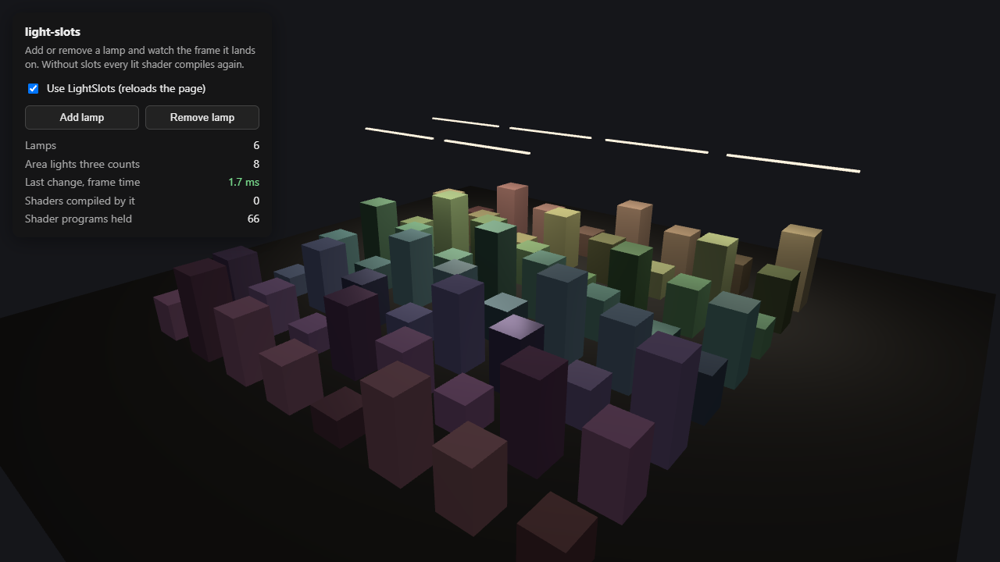
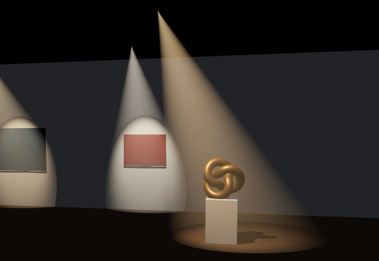
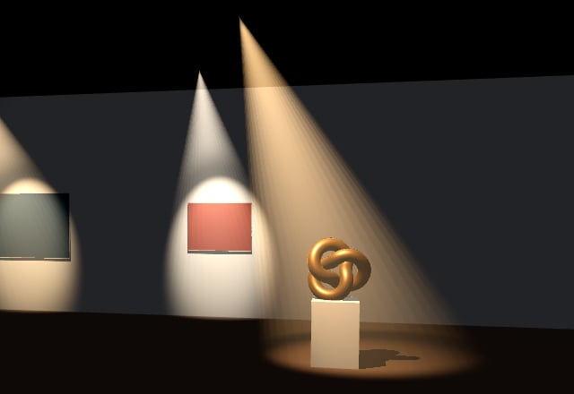
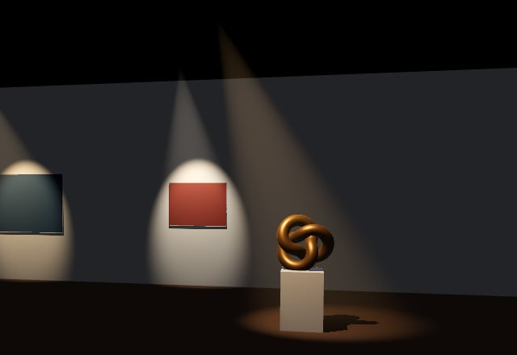
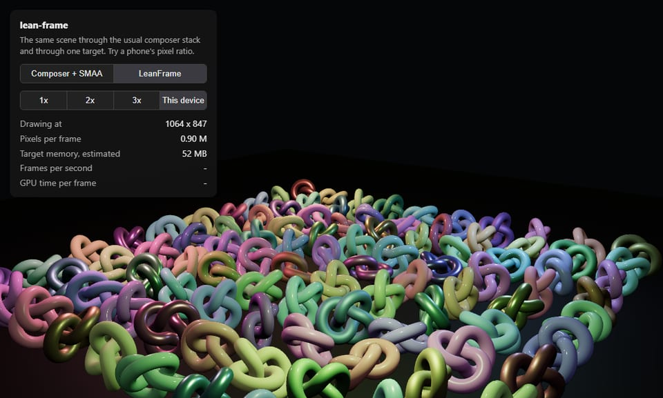

# threejs-extras

I'm building a 3D editor for galleries and museums in three.js, and every so often I hit something three.js leaves
for you to figure out. When the fix turns out small and general enough, it goes here as its own package, with a demo
that shows the before and after. The [demos](https://burakturan.github.io/threejs-extras/) run in the browser.

## [light-slots](packages/light-slots)

Hanging one more lamp froze the view for a second or more, because three.js recompiles every lit shader when the
number of lights changes. `LightSlots` keeps the count steady, so the frame a lamp lands on takes a couple of
milliseconds instead.

**[Live demo](https://burakturan.github.io/threejs-extras/light-slots/)**

[](https://burakturan.github.io/threejs-extras/light-slots/)

## [spot-beam](packages/spot-beam)

A visible beam for a spot light. A transparent cone cuts the wall and floor with a hard line, and fading it near the
scene's depth softens the line but leaves a hard-sided surface. This one marches through the volume against the
scene's depth, so the haze itself thins out where it meets a surface.

**[Live demo](https://burakturan.github.io/threejs-extras/spot-beam/)**

| Plain cone | Soft cone | SpotBeam |
| --- | --- | --- |
| [](https://burakturan.github.io/threejs-extras/spot-beam/) | [](https://burakturan.github.io/threejs-extras/spot-beam/) | [](https://burakturan.github.io/threejs-extras/spot-beam/) |

## [lean-frame](packages/lean-frame)

The composer chain I drew every frame through felt heavy on a phone. `LeanFrame` draws through one multisampled
target and one output pass at a pixel ratio capped at 1.5. On my phone that held 37 MB of targets instead of 67 and
ran a little faster; on a desktop at the same pixel count it is actually slower, and the README has the numbers.

**[Live demo](https://burakturan.github.io/threejs-extras/lean-frame/)**

[](https://burakturan.github.io/threejs-extras/lean-frame/)

## Run locally

```bash
pnpm install
pnpm dev
```

MIT licensed.
