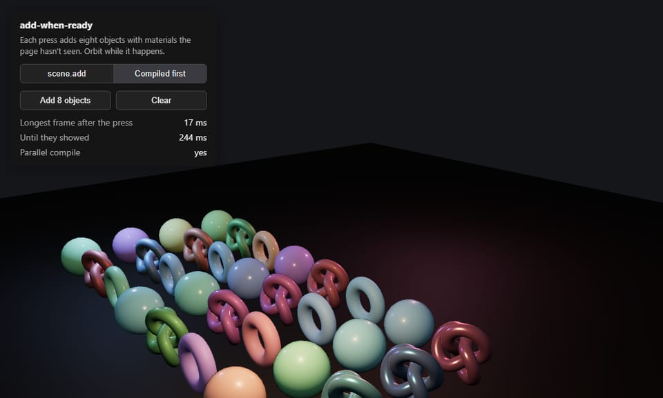
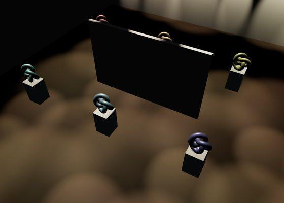
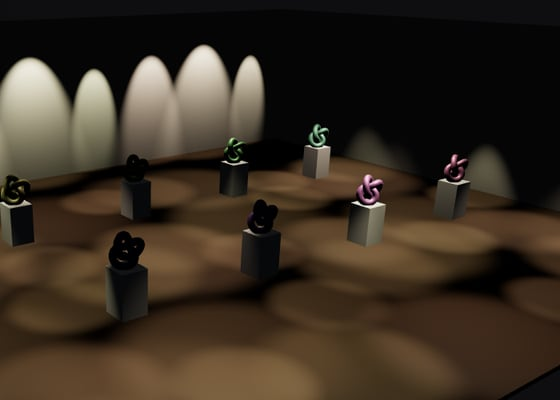
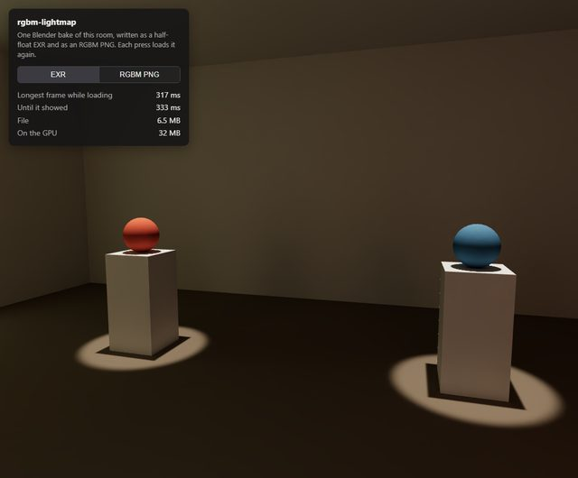
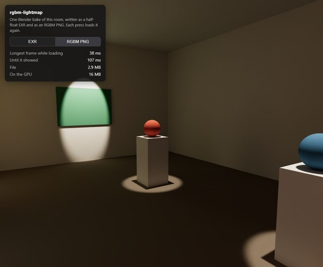

# threejs-extras

I'm building a 3D editor for galleries and museums in three.js, and every so often I hit something three.js leaves
for you to figure out. When the fix turns out small and general enough, it goes here as its own package, with a demo
that shows the before and after. The [demos](https://burakturan.github.io/threejs-extras/) run in the browser.

## [light-slots](packages/light-slots)

Hanging one more lamp froze the view for a second or more, because three.js recompiles every lit shader when the
number of lights changes. `LightSlots` keeps the count steady, so the frame a lamp lands on takes a couple of
milliseconds instead.

**[Live demo](https://burakturan.github.io/threejs-extras/light-slots/)**

[](https://burakturan.github.io/threejs-extras/light-slots/)

## [spot-beam](packages/spot-beam)

A visible beam for a spot light. A transparent cone cuts the wall and floor with a hard line, and fading it near the
scene's depth softens the line but leaves a hard-sided surface. This one marches through the volume against the
scene's depth, so the haze itself thins out where it meets a surface.

**[Live demo](https://burakturan.github.io/threejs-extras/spot-beam/)**

| Plain cone | Soft cone | SpotBeam |
| --- | --- | --- |
| [](https://burakturan.github.io/threejs-extras/spot-beam/) | [](https://burakturan.github.io/threejs-extras/spot-beam/) | [](https://burakturan.github.io/threejs-extras/spot-beam/) |

## [lean-frame](packages/lean-frame)

The composer chain I drew every frame through felt heavy on a phone. `LeanFrame` draws through one multisampled
target and one output pass at a pixel ratio capped at 1.5. On my phone that held 37 MB of targets instead of 67 and
ran a little faster; on a desktop at the same pixel count it is actually slower, and the README has the numbers.

**[Live demo](https://burakturan.github.io/threejs-extras/lean-frame/)**

[](https://burakturan.github.io/threejs-extras/lean-frame/)

## [add-when-ready](packages/add-when-ready)

A new kind of object froze the view for most of a second while its shader compiled on the first frame. `addWhenReady`
compiles it in the background with three's `compileAsync`, against the scene's lights and the frame's target, and
only then adds it. In the demo the longest frame went from about 930 ms to under 15.

**[Live demo](https://burakturan.github.io/threejs-extras/add-when-ready/)**

[](https://burakturan.github.io/threejs-extras/add-when-ready/)

## [light-grid](packages/light-grid)

Sixty spots in a hall meant sixty light evaluations on every pixel, and a recompile whenever the count changed.
`LightGrid` keeps the spots in a texture and cuts the floor plan into cells, each listing the few spots that reach it,
so a pixel lights itself with those alone through the material's own lighting. In the demo the frame went from about
10 ms to under 3, and it looks the same.

**[Live demo](https://burakturan.github.io/threejs-extras/light-grid/)**

| 60 SpotLights | LightGrid |
| --- | --- |
| [](https://burakturan.github.io/threejs-extras/light-grid/) | [](https://burakturan.github.io/threejs-extras/light-grid/) |

## [rgbm-lightmap](packages/rgbm-lightmap)

A baked HDR lightmap as a half-float EXR froze the view for about 300 ms while `EXRLoader` parsed it on the main
thread. I wrote the same bake as an RGBM PNG, which the browser decodes off the main thread: the file went from 6.5 MB
to 2.9 MB and GPU memory from 32 MB to 16. `readRGBM` turns it back into light in the material's shader, and I
couldn't see a difference in the demo room.

**[Live demo](https://burakturan.github.io/threejs-extras/rgbm-lightmap/)**

| EXR | RGBM PNG |
| --- | --- |
| [](https://burakturan.github.io/threejs-extras/rgbm-lightmap/) | [](https://burakturan.github.io/threejs-extras/rgbm-lightmap/) |

## Run locally

```bash
pnpm install
pnpm dev
```

MIT licensed.
