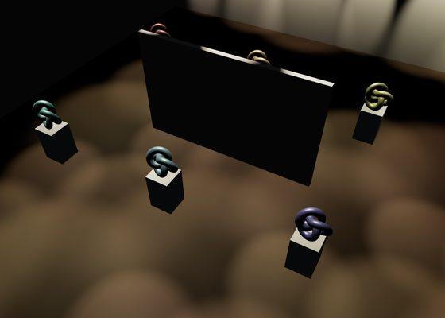
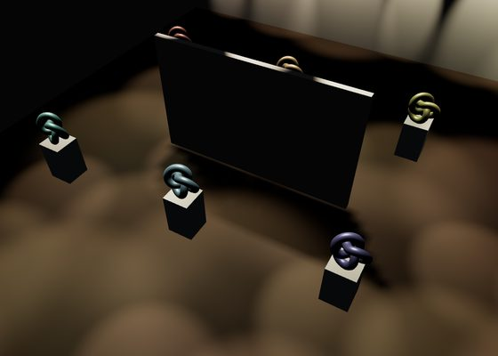

# @threejs-extras/light-grid

One of the gallery halls I built had sixty spots. three.js lights every pixel with every light in the scene, so a
pixel of floor in one corner still works through the spot on the far wall, sixty times over. And the lit shaders are
written for exactly sixty lights: a count three hasn't drawn with before compiles them all again. The hall was slow to
open and slow to look at.

`LightGrid` keeps the spots out of the scene. They go into a texture, the floor plan is cut into cells, and each cell
lists the few spots whose light reaches it. A pixel finds its cell and lights itself with those, through the
material's own `RE_Direct`, so a spot looks the way an unshadowed `SpotLight` would. The shader doesn't change with how
many spots there are. Games call this tiled or clustered lighting; three has a clustered version for the
`WebGPURenderer` (`ClusteredLighting` in the addons), and nothing like it for the `WebGLRenderer` I draw with.

Unshadowed light goes through walls, and sixty shadow maps are out of the question. Give the grid the walls and each
spot works out once, on the CPU, what it can see of the plan; the shader reads that back, so a partition throws its
shadow on the floor behind it.

**[Live demo](https://burakturan.github.io/threejs-extras/light-grid/)**

| 60 SpotLights | LightGrid with walls |
| --- | --- |
|  |  |

## What it changes

The demo is a 24 by 16 hall: sixty spots, two free partitions, twelve plinths with a metal knot on each, standard
materials. Desktop Chrome, GTX 1060, 1064 by 881, GPU time from a timer query, five rounds each:

| | GPU time per frame | Grid built in |
| --- | --- | --- |
| 60 SpotLights | 10.9 to 12.7 ms | |
| LightGrid | 2.2 to 2.8 ms | 13 to 19 ms |
| LightGrid with walls | 2.3 to 2.6 ms | 29 to 34 ms |

With one-metre cells and eight spots a cell, no cell had more
candidates than slots. The grid is built on the main thread.

The first frame after switching to the sixty SpotLights took 2426 ms the first time and 855 ms with the browser's
shader cache warm, while they compiled. The grid's shader is the same with walls or without; its first frame took
158 ms the first time.

## Use

```ts
import { LightGrid } from '@threejs-extras/light-grid'

const grid = new LightGrid({ area: new THREE.Box3(min, max), cell: 1, perCell: 8 })
grid.set(spots) // SpotLights, not added to the scene
grid.set(spots, { walls: [partitionA, partitionB] }) // or with what stands in their light
for (const material of litMaterials) grid.apply(material)
```

`area`'s x and z are the plan the cells cover, and grid light stops at its edges. Its y range only sets where a cell is tested
when choosing its spots, at the bottom, middle and top; grid light isn't cut off above or below it. `apply` works on the built-in lit
materials (standard, physical, lambert, phong, toon) through `onBeforeCompile`; call it before the material first
compiles. If a spot or a wall moves, or a spot changes colour, intensity, distance, decay, angle or penumbra, call
`set` again. The shaders stay as they are, only the textures change.

Each mesh under `walls` counts as its geometry's box where it stands in the world, turned with it. A curved wall or a
mesh with a hole in it blocks as the whole box.

| Option | Default | |
| --- | --- | --- |
| `area` | | The box the spots light. |
| `cell` | `1` | A cell's side in scene units. Smaller cells hold fewer spots each and cost more to build. |
| `perCell` | `8` | The most spots a cell takes, rounded up to a multiple of 4. Past it the weakest are left out. |
| `sight.step` | `cell / 4` | With walls, how finely the plan is sampled for what each spot sees. |
| `sight.heights` | 5% and 60% up `area` | With walls, the two heights it's sampled at. |

`set` returns how many cells were reached by more spots than `perCell`. If it isn't 0, some light is missing there:
raise `perCell` or shrink `cell`. A 0 doesn't prove every spot was found, see below. With walls, a cell's spare slots
also take the spots that light its neighbours, so a shadow's soft edge carries over the cell's border; those don't
count toward what `set` returns.

## The catch

Only the meshes passed as `walls` block grid light. The grid doesn't read a spot's `map` or its shadow settings.

What a spot sees is sampled at two heights and blended between them, which suits walls that stand from the floor to
above the upper height. Anything shorter casts its low shadow onto what stands on top of it: I tried the plinths as
walls, and the knots on them and the plinths' own tops went dark. In the demo only the partitions are walls. The
shadow's edge follows the `sight.step` samples, so a wall at a slant gives it small steps.

The sight texture holds two slabs of the plan for each spot and stops at 4096 texels a side. Past that, a wall still
keeps a spot out of the cells it hides completely, but the shadow follows the cells' edges instead of the wall.

A cell is weighed at nine points across and three heights. A narrow spot that only touches a cell between those points
isn't listed for it and leaves a gap, even with slots free. One-metre cells and gallery spots haven't hit that for me;
smaller cells make it less likely.

Every pixel inside the plan still loops over `perCell` slots, filled or not, and reads four texels from a float
texture for each spot it lights with, and two more with walls. With only a handful of spots, plain `SpotLight`s are
cheaper.

It needs three r187 or later.

MIT licensed.
