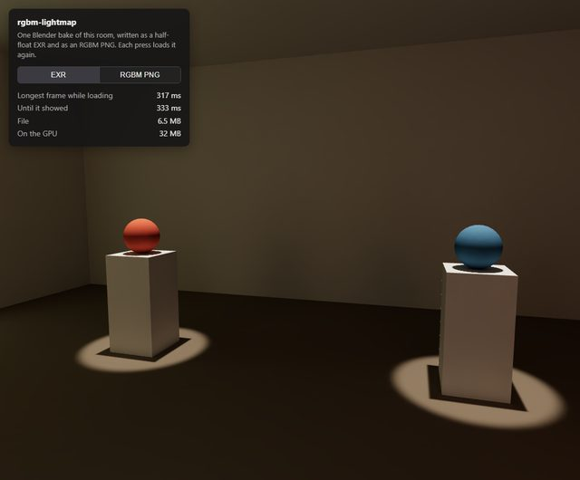
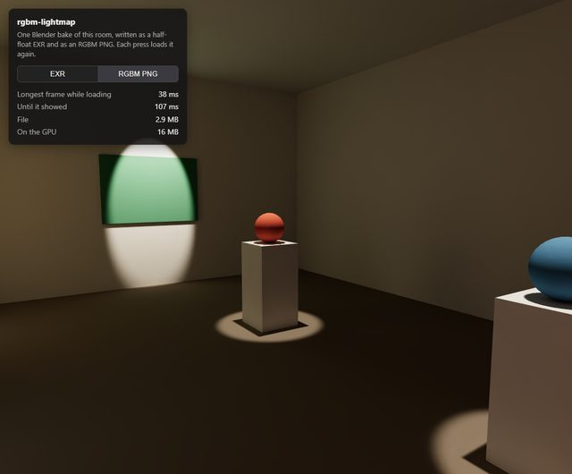

# @threejs-extras/rgbm-lightmap

The gallery editor bakes each room's light in Blender and draws it as a lightmap. The bake is HDR: under a spot the
light goes well past 1, and an ordinary 8-bit PNG clips it there. Half-float EXR through three's `EXRLoader` keeps it,
but the loader parses the file in JavaScript on the main thread. In the demo a 2048 lightmap froze the view for about
300 ms while it did, and on the GPU it takes 8 bytes a texel.

RGBM keeps HDR light in an ordinary 8-bit PNG. Each texel stores a colour and a multiplier in alpha; the shader
multiplies them together, squares the result and scales it by the range to get the light back. `loadRGBM` hands the PNG to the browser's image decoder through `createImageBitmap`,
which works off the main thread, and the GPU keeps 4 bytes a texel. `readRGBM` changes the material's shader to decode
RGBM when it samples the lightmap. three r187 has no RGBM loader. Its `UltraHDRLoader` also lets the browser decode
its JPEGs, but then goes over every pixel in JavaScript to build a half-float texture.

**[Live demo](https://burakturan.github.io/threejs-extras/rgbm-lightmap/)**

| EXR | RGBM PNG |
| --- | --- |
|  |  |

## What it changes

The demo is one room, baked once in Cycles into a 2048 lightmap (`rgbm-lightmap/bake.py`). The light is written twice,
as a half-float EXR with ZIP compression and as an RGBM PNG. Each press loads the chosen file again, from the HTTP
cache after the first time, while the camera keeps turning. Desktop Chrome, GTX 1060, five rounds each:

| | File size | GPU memory | Longest frame while loading | Time until visible |
| --- | --- | --- | --- | --- |
| EXR, `EXRLoader` | 6.5 MB | 32 MB | 279 to 300 ms | 294 to 329 ms |
| RGBM PNG, `loadRGBM` | 2.9 MB | 16 MB | 8 to 13 ms | 55 to 57 ms |

I also compared the decoded PNG with the EXR texel by texel, measuring the relative error in luminance. Over the
70% of texels whose luminance in the EXR is above 0.01, the median error was 0.16% and the largest 0.49%. I didn't
measure the darker ones.

## Use

```ts
import { loadRGBM, readRGBM } from '@threejs-extras/rgbm-lightmap'

const light = await loadRGBM('room-light.png')
light.channel = 1 // the UV set the lightmap was unwrapped to
for (const material of bakedMaterials) {
  material.lightMap = light
  readRGBM(material, 16) // the range the PNG was written with
}
```

`readRGBM` works on the basic material and the lit ones (lambert, phong, standard, physical, toon). Call it before the
material first compiles. To change the range later, call it again with the new value; that updates a uniform and
doesn't recompile the shader.

`loadRGBM` doesn't flip the image, which matches glTF UVs. Pass `{ flipY: true }` for UVs whose v runs from the bottom
of the image up, as on three's built-in geometries.

How bright the lightmap should be depends on what was baked. Cycles' diffuse bake without its colour pass gives what a
white surface sends back, and three treats a lightmap as incoming light, so the demo sets `lightMapIntensity` to
`Math.PI`.

## Writing the PNG

Run `blender/rgbm.py` inside Blender to turn a baked EXR into an RGBM PNG:

```python
from rgbm import save_rgbm
peak = save_rgbm('light.exr', 'light.png', light_range=16)
```

It writes `sqrt(light / light_range)`, so dim light keeps more of the 8 bits. Anything above `light_range` is clipped.
It returns the highest RGB value in the EXR; if that's above the range, pick a larger one and write the PNG again. The
demo's peak is 5.1 and its range 16.

## The catch

The alpha is a multiplier, so nothing between the file and the shader may premultiply it or convert its colour.
`loadRGBM` turns both off. A tool that rewrites the PNG and treats alpha as transparency spoils it the same way.

The GPU blends the encoded values before the shader decodes them. Between a bright texel and a dim one, that isn't
quite the blend of the original light. There are no mipmaps for the same reason, so a lightmap seen at a steep angle
can shimmer.

A device with HDR block compression (BC6H on desktops, ASTC HDR on some phones) can hold the same lightmap as KTX2
UASTC HDR in less memory than this, with three's `KTX2Loader`. I haven't measured that here. RGBM is for the devices
without it and for a pipeline that only needs PNGs.

It needs three r187 or later.

MIT licensed.
