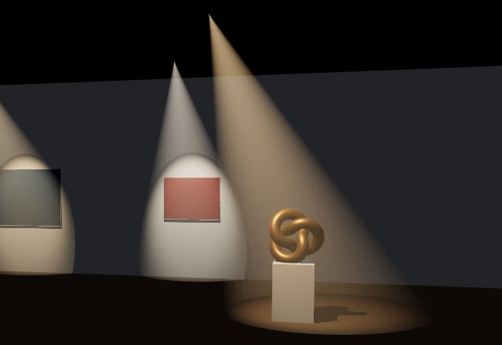
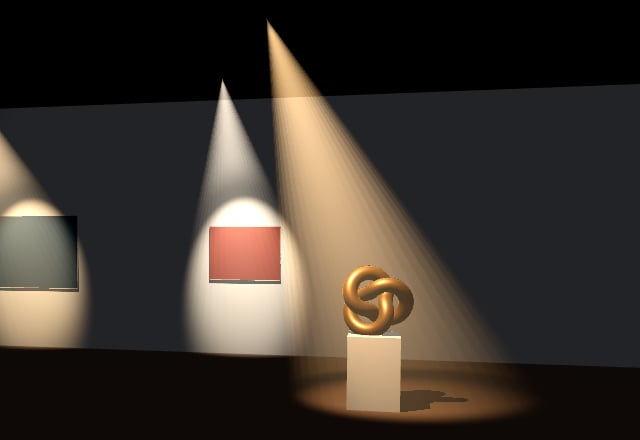
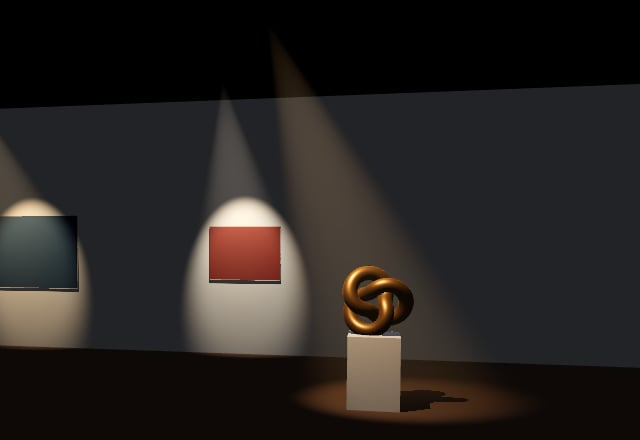

# @threejs-extras/spot-beam

The galleries I build in three.js are dark rooms with a few spots on the work, and a little haze in the air is what
makes them read as lit. The usual way to get that is a transparent cone, additive, fading along its length. It works
until you look where the cone meets the wall or the floor: it cuts them with a hard elliptical line, and the edge of
the cone is as sharp as the middle.

The known fix for the line is to fade the cone's surface as it comes near the scene's depth, the way soft particles
fade into the ground. That takes the line away, and it's cheap. What it keeps is a surface: the cone's sides stay as
sharp as before, the spot's penumbra doesn't show in it, and with the camera inside you look at the cone's inner wall
rather than haze around you. The demo has both cones next to `SpotBeam`.

| Plain cone | Soft cone | SpotBeam |
| --- | --- | --- |
|  |  |  |

`SpotBeam` marches each pixel's sight line through the light's cone and adds up what the haze would scatter toward the
eye: the spot's own soft edge, a falloff with distance, and a little more light when you look into the beam than
across it. The march stops at the scene's depth, so the beam thins out where it reaches a surface instead of being cut
by it, and anything in front hides it. The camera can stand inside a beam too.

The depth part is what bit me. When I added a lighter render path for phones, the beams lost the depth texture they
read and started showing through walls. So the beam doesn't guess: you render the scene into a target that keeps its
depth, and hand that over.

**[Live demo](https://burakturan.github.io/threejs-extras/spot-beam/)**

## Use

```ts
import { SpotBeam, useDepth } from '@threejs-extras/spot-beam'

const beam = new SpotBeam(spot, { steps: 24, strength: 0.35 })
const beams = new THREE.Scene().add(beam)

const size = renderer.getDrawingBufferSize(new THREE.Vector2())
const target = new THREE.WebGLRenderTarget(size.x, size.y, {
  type: THREE.HalfFloatType,
  depthTexture: new THREE.DepthTexture(size.x, size.y),
})
renderer.autoClear = false

function frame() {
  renderer.setRenderTarget(target)
  renderer.clear()
  renderer.render(scene, camera)

  renderer.setRenderTarget(null)
  renderer.clear()
  drawToScreen(target.texture) // a full-screen quad, see below

  useDepth(target, camera)
  renderer.render(beams, camera)
}
```

The beams live in their own scene so the main scene's background can't paint over them, and `autoClear` is off so
drawing them doesn't wipe the frame. `drawToScreen` is a full-screen quad with three's tone mapping and colour space
chunks; the [demo](../../src/spot-beam.ts) has one in a dozen lines. With an `EffectComposer`, pass `useDepth` the
target the scene pass wrote its depth into, and draw the beams over the composer's result.

Keep the target the size of the drawing buffer, and resize it with the renderer. The camera has to be the same
perspective camera for both passes. Call `beam.update()` when the light moves, turns, or changes colour or penumbra.

| Option | Default | |
| --- | --- | --- |
| `reach` | the light's `distance`, else 6 | How far the beam goes, in scene units. |
| `strength` | `0.35` | Scales the beam's colour. It doesn't follow the light's intensity. |
| `steps` | `24` | Samples along each sight line, at least 4. Fewer gets grainy, more costs more. |

`reach` and the light's `angle` shape the cone mesh when the beam is made; change either and make a new beam. For
`strength` on the fly, set `beam.material.uniforms.strength.value`. The beam sets its own world position, so add it
straight to a scene, not under a moved group. `beam.dispose()` frees it.

## The catch

It costs per pixel the beam covers, times `steps`. I timed it on the GPU with a timer query, at 1064 by 847 on a
GTX 1060. The whole frame came out anywhere from 0.7 to 3.7 ms from one sitting to the next, as the card's clocks
moved, but within a sitting the four modes and the step counts landed within about 0.15 ms of each other. At this size
the beams are lost in the noise; the shadows cost far more. I haven't measured it on a phone yet.

It doesn't know about shadows. A sculpture standing in the beam casts its shadow on the floor, but the haze behind it
still glows. For a gallery spot aimed at a work that's rarely visible; for a spot shining through a window frame it
would be. Glass and other transparent surfaces that don't write depth won't hide it either.

MIT licensed.
